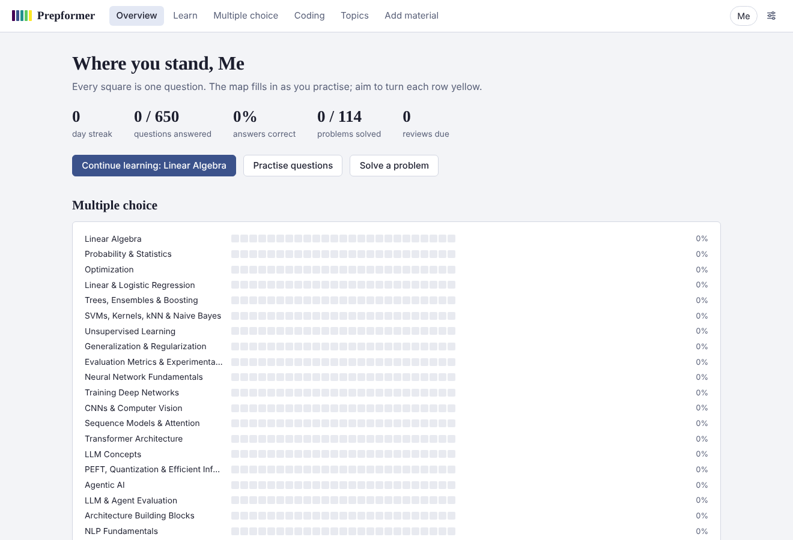
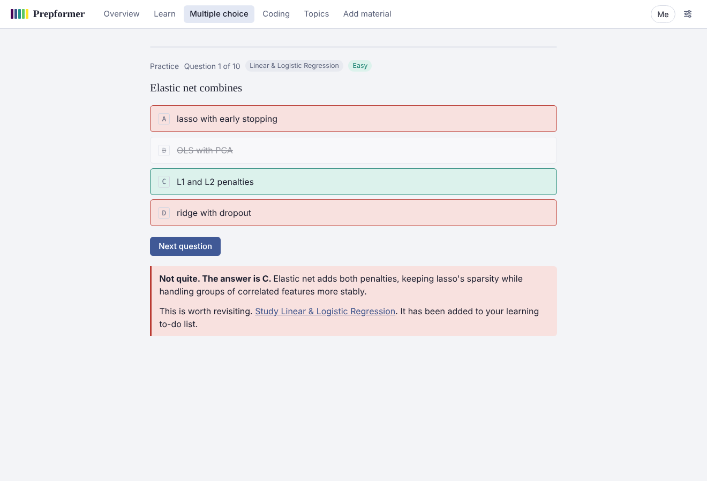
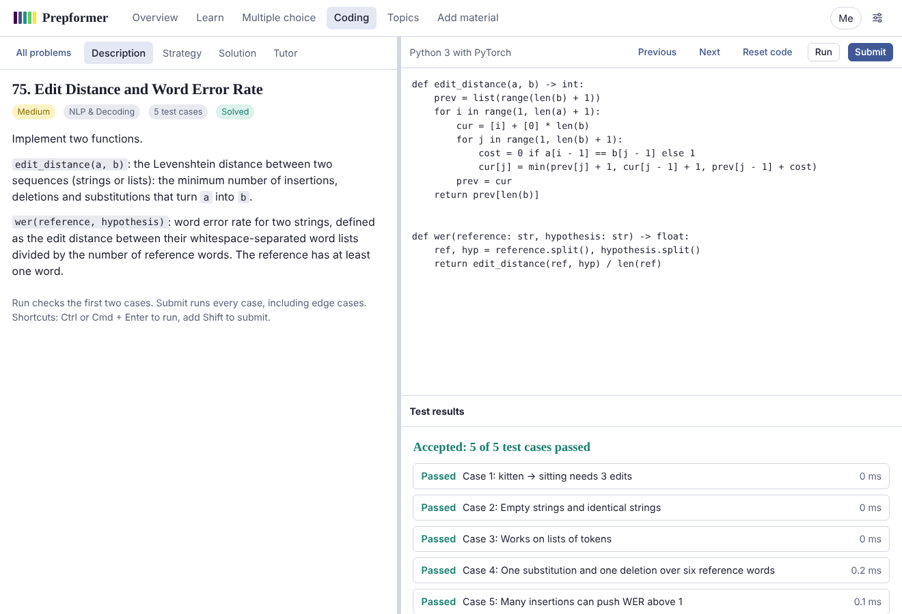

# Prepformer

ML interview prep that runs your code. A local web app for machine-learning research and engineering interviews: lessons, 650 multiple-choice questions and 114 PyTorch coding problems checked against hidden test cases, with your progress tracked in a single SQLite file on your own machine.



## What it does

**Learn.** Pick a goal (LLM research engineer, applied AI and agents, ML generalist, computer vision, ranking) and get a prerequisite-ordered plan across 26 topics. For each topic: a five-question diagnostic with a confidence rating, short lessons built as predict, read, check, and spaced review in which the topic is hidden until you ask for a hint.

**Multiple choice.** 650 questions, 25 per topic.

- *Practice*: a miss gets a hint and a second try; a second miss shows the explanation, links the lesson and adds the topic to your to-do list.
- *Exam*: 25 questions in 15 minutes with no feedback until the end, then a to-do list built from the topics you missed.



**Coding.** 114 problems in Python with PyTorch, in a LeetCode-style workspace. Run checks two sample cases; Submit runs the full suite, including edge cases.

- *Practice*: a step-by-step Strategy tab, then the reference Solution.
- *Exam*: 3 problems in 60 minutes, with strategy, solution and tutor locked.



**Add material.** Give it a paper, book chapter, blog post or your own notes (text, link or PDF) and Claude drafts new multiple-choice and coding questions, filed under an existing topic or a new one. You review everything before it joins your bank, and a generated coding problem is kept only if its reference solution passes its own tests on your machine.

**Profiles.** Named profiles with streak, daily activity, exam history and per-topic progress.

The full topic list, with subtopics and every coding problem, is in [docs/topics.md](docs/topics.md). It spans classical ML, deep learning, Transformers, LLM concepts, PEFT and quantization, agentic AI, LLM and agent evaluation, architecture building blocks, generative models, RL, recommender systems, ML system design and PyTorch.

## Quick start

You need [uv](https://docs.astral.sh/uv/). Everything else is installed by it.

```
git clone https://github.com/Neisarg/Performer.git
cd Performer
uv sync            # creates .venv with PyTorch and NumPy
uv run server.py   # opens http://127.0.0.1:8765
```

On macOS you can also double-click `start.command`.

Options:

```
uv run server.py --port 9000 --no-browser
uv run server.py --python /path/to/another/python    # an interpreter that has torch
```

Multiple choice and lessons work even if PyTorch is not installed; only running code needs it.

## Claude features (optional)

Open Settings (top right) and paste an Anthropic API key, or start the server with `ANTHROPIC_API_KEY` set. This enables:

- a tutor session on every topic (it finds where your understanding ends, then teaches one step at a time)
- tailored hints on missed questions
- hints and reviews on your code
- question generation from your own material

The key is stored only in `user_data/prepformer.db` on your machine and sent only to `api.anthropic.com`. The model name is editable in Settings.

## How code runs, and a safety note

The server uses only the Python standard library. When you press Run or Submit, your code and the problem's tests are executed by `runner.py` in a separate Python process with a 45 second limit.

There is no sandbox: your code runs with your user's permissions, exactly as if you had run it in a terminal. The server therefore listens on `127.0.0.1` only and rejects requests from other origins. Do not expose it to a network, and read generated coding problems before running them.

## Your data

Everything you do is stored in `user_data/prepformer.db` (SQLite): profiles, every answer and submission, exam results, the to-do list, the review schedule, saved code, settings and imported questions. Back up or delete that one file to back up or reset. It is excluded from git.

## Adding or editing questions

The bank is plain text in `content/`. Edit it and restart the server (it rebuilds `data/` automatically), or run `uv run build.py`.

Multiple choice, in `content/mcq/*.txt`: a `# topic:` and `# id:` header, then blocks separated by blank lines.

```
Q: Question text [M]            <- difficulty tag: [E], [M] or [H]
- a wrong option
* the correct option
- a wrong option
- a wrong option
> One or two sentences of explanation.
```

Coding problems, in `content/problems/*.txt`: each starts with `=== id | Title | Easy|Medium|Hard`, followed by the sections `--- description`, `--- starter`, `--- solution`, `--- tests` and `--- hints`. Tests are functions named `test_*` with a one-line docstring. They can use every name the solution defines, plus `torch`, `math`, `random` and the helpers `check_close`, `check_equal`, `check_shape` and `check_true`.

Lessons are in `content/learn/lessons.txt`; the format is described at the top of that file.

## Checking the coding problems

```
uv run verify.py
```

runs every reference solution against its tests with your PyTorch, and confirms that the unfinished starter code does not pass. Results go to `verify_report.json`.

## Status

This is an early release. Known limitations:

- The reference solutions for the PyTorch-dependent problems have not all been verified against real PyTorch. Run `uv run verify.py`; if a problem fails, the fix belongs in `content/problems/`, and reports are welcome.
- In many multiple-choice questions the correct option is also the longest one.
- Lessons are short summaries (95 ideas), not full course material.
- The Claude features have been exercised against a mock of the API, not extensively against the live service.

## Project layout

```
server.py        local web server, SQLite storage, Claude calls
runner.py        runs a solution against a problem's tests in a separate process
build.py         compiles content/ into data/*.json
verify.py        checks all reference solutions with your PyTorch
content/         question bank and lessons (plain text)
web/             the interface (plain JavaScript, no build step)
docs/            topic list and screenshots
pyproject.toml   dependencies, managed by uv
```

The code editor (CodeMirror) and the fonts load from public CDNs when you are online. Offline, the app falls back to a plain editor and system fonts.

## Acknowledgements

The Learn section's loop of measure, plan, teach and practice is modeled on [LearnHarness](https://github.com/amosblomqvist/learnharness). No code from it is included.

## License

Prepformer is source-available under the [PolyForm Noncommercial License 1.0.0](LICENSE.md): free for personal study and other noncommercial use. Commercial use needs separate permission.
